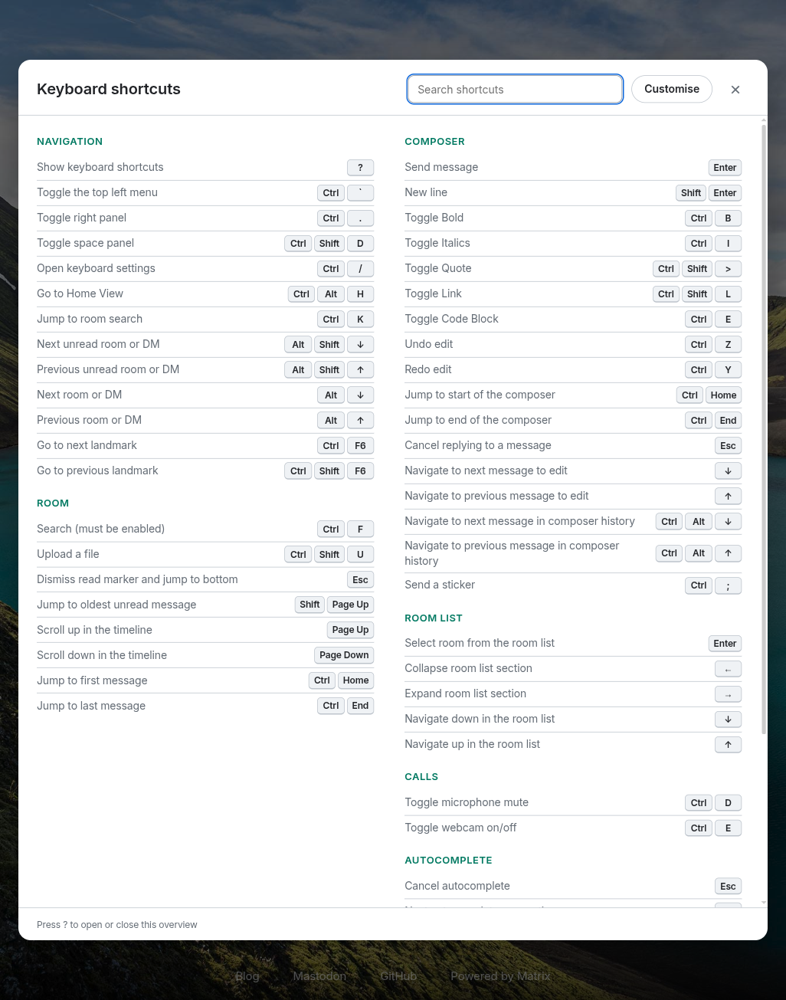
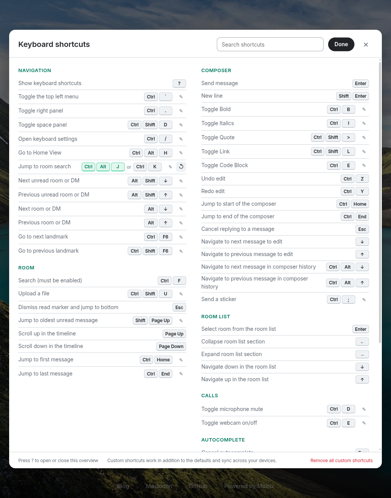

# Keyboard Shortcuts module for Element Web

Press <kbd>?</kbd> anywhere in Element Web to see every keyboard shortcut in a Gmail-style overlay. Users can also add their own shortcuts for Element's global actions. Custom shortcuts sync across their devices.



| What                    | How                                                                                                                                         |
| ----------------------- | ------------------------------------------------------------------------------------------------------------------------------------------- |
| Open / close            | <kbd>?</kbd> (when you're not typing in a text field), <kbd>Esc</kbd>, the × button, or a click on the backdrop                             |
| Find a shortcut         | Type in the search box. It matches both labels and keys, e.g. `bold` or `shift`                                                             |
| Add your own shortcut   | **Customise** → ✎ next to an action → press the new combo. **Esc** cancels                                                                 |
| Remove your shortcut(s) | **Customise** → ↺ on a row, or **Remove all custom shortcuts**                                                                              |



## Features

- **All of Element's shortcuts, grouped like Element's Settings → Keyboard tab**: Navigation, Room, Composer, Room list, Calls, Autocomplete, Accessibility and Labs. The overlay only shows shortcuts that apply to the current platform: Mac symbols (⌘ ⌥ ⇧) on macOS, and desktop-only shortcuts only in Element Desktop. The Labs section appears only when labs are shown. The Send / New line keys follow the user's *Ctrl+Enter to send* setting.
- **Element's own translations.** Labels use Element's translation keys, so the overlay shows the user's language. The module adds English and German strings for its own UI.
- **Theme-aware.** The overlay uses Element's Compound design tokens, so it follows light, dark and high-contrast themes. It also works at phone width.
- **Custom shortcuts are aliases.** A custom shortcut works *in addition to* the default. Pressing it makes Element behave exactly as if the default was pressed. Custom shortcuts are stored in the user's account data (`de.datanauten.keyboard_shortcuts`), so they follow the user to every device. The module rejects combos that would clash with typing (no Ctrl/Alt/⌘) or with another shortcut.
- **Admin config.** Admins can hide categories or individual shortcuts, list shortcuts from other modules or integrations, change the trigger key, or turn customisation off.

## Requirements

- Element Web or Element Desktop with module API **≥ 2.0.0** (Element Web v1.12.x ships 2.2.x; tested against **v1.12.32**).
- No other dependencies. The module is one ES module file (~73 kB, 19 kB gzipped) that reuses Element's React.

## Installation

1. Build it, or take `lib/` from a release:

   ```sh
   pnpm install
   pnpm build          # → lib/index.js (+ lib/index.js.map)
   ```

2. Serve `lib/index.js` from the same origin as Element Web. With the official Docker image, mount the directory under the nginx root `/app`, e.g. at `/app/element-modules/keyboard-shortcuts`.
3. List it in Element's `config.json`:

   ```json
   {
       "modules": ["/element-modules/keyboard-shortcuts/index.js?v=<content hash>"]
   }
   ```

   Change `?v=` on every update. The image's nginx sends no cache headers for module files, so browsers otherwise keep running the old build.

> **Docker image gotcha:** don't rely on the image's `/modules` auto-loader. It only rewrites `config.json`. If a `config.<hostname>.json` exists (matrix-docker-ansible-deploy always creates one), Element reads that file instead and the module never loads. List the module explicitly. See [docs/deployment.md](docs/deployment.md).

For matrix-docker-ansible-deploy (as used for datanauten.de), see **[docs/deployment.md](docs/deployment.md)**.

## Configuration

All options are optional. Without any configuration the module works with the defaults below. Options go under `de.datanauten.keyboard_shortcuts` in `config.json`:

```json
{
    "de.datanauten.keyboard_shortcuts": {
        "trigger_key": "?",
        "allow_customisation": true,
        "hidden_categories": ["accessibility"],
        "hidden_shortcuts": ["KeyBinding.toggleHiddenEventVisibility"],
        "extra_shortcuts": [
            {
                "label": { "en": "Open the Marcade store", "de": "Marcade-Store öffnen" },
                "keys": "Mod+Shift+M",
                "category": "navigation"
            }
        ]
    }
}
```

| Option                | Default | Meaning                                                                                                                                                                                                                                           |
| --------------------- | ------- | ------------------------------------------------------------------------------------------------------------------------------------------------------------------------------------------------------------------------------------------------- |
| `trigger_key`         | `"?"`   | Key that opens the overlay. A single character (like `?`) matches whatever key produces that character on the user's keyboard layout. It never fires while typing in a text field or while an Element dialog is open. A combo such as `"Mod+Shift+/"` matches exactly. |
| `allow_customisation` | `true`  | Show **Customise** and apply users' custom shortcuts. With `false`, existing custom shortcuts are ignored but not deleted.                                                                                                                       |
| `hidden_categories`   | `[]`    | Any of `navigation`, `room`, `composer`, `room_list`, `calls`, `autocomplete`, `accessibility`, `labs`, `custom`.                                                                                                                                 |
| `hidden_shortcuts`    | `[]`    | Element `KeyBindingAction` ids, as listed in [`src/catalog.ts`](src/catalog.ts).                                                                                                                                                                  |
| `extra_shortcuts`     | `[]`    | Extra rows that are listed only. The module doesn't make them work. `label` is a string or a `{ language: text }` map. `keys` uses the combo syntax below. `category` is one of the ids above (default: a "More" section).                       |

**Combo syntax:** modifiers and a key joined by `+`. Modifiers are `Mod` (Ctrl on Windows/Linux, ⌘ on macOS), `Ctrl`, `Meta`/`Cmd`, `Alt`/`Option` and `Shift`. The key is a character or a [`KeyboardEvent.key`](https://developer.mozilla.org/en-US/docs/Web/API/UI_Events/Keyboard_event_key_values) name such as `ArrowUp`, `PageDown`, `Escape` or `F6`. `Up`, `Down`, `Esc`, `Space` and `Plus` also work. Invalid combos make the module fail at startup, with the error in the browser console.

## Limitations

- **Defaults can't be removed or replaced, only extended.** Element Web has no API for rebinding keys, so a custom shortcut is an alias that replays the default key press (see [docs/architecture.md](docs/architecture.md)). Only actions that work the same everywhere can be customised. Context-dependent keys (arrows, Enter, Esc, Page Up/Down, Tab, Ctrl+1–9) can't.
- **Browser-reserved combos can't be used.** For example, Ctrl+T, Ctrl+W and Ctrl+N never reach web pages in most browsers, so recording them does nothing useful.
- **The list is a snapshot.** Element doesn't expose its shortcut table to modules, so the module ships its own copy (`src/catalog.ts`, taken from Element Web develop, September 2026). If a new Element version adds a shortcut, update the catalog. The labels come from Element's translations, and the module falls back to English for keys an older Element doesn't have.
- **Custom shortcuts sync only after login.** Before the user logs in, custom shortcuts are kept in `localStorage` and uploaded on first login.

## Development

```sh
pnpm install
pnpm test          # vitest + jsdom: key handling, catalog, config, overlay & remapping flows
pnpm lint:types    # tsc
pnpm build         # vite library build → lib/
pnpm dev           # rebuild on change
```

To try it in a real Element, run the official image with the build mounted:

```sh
podman run --rm -p 8089:8080 -e ELEMENT_WEB_PORT=8080 \
  -v "$PWD/dev-config.json:/app/config.json:ro,Z" \
  -v "$PWD/dev-config.json:/app/config.localhost.json:ro,Z" \
  -v "$PWD/lib:/app/element-modules/keyboard-shortcuts:ro,Z" \
  ghcr.io/element-hq/element-web:v1.12.32
```

Here `dev-config.json` holds `"modules": ["/element-modules/keyboard-shortcuts/index.js?v=1"]` plus your homeserver. Bump `?v=` and restart the container after each rebuild, because Element and the image cache both the config and the module.

Further reading:

- [docs/element-web-modules.md](docs/element-web-modules.md): how Element Web modules work in general, and where the upstream docs are.
- [docs/architecture.md](docs/architecture.md): how this module works and why it's built this way.
- [docs/deployment.md](docs/deployment.md): deploying with matrix-docker-ansible-deploy.

## License

AGPL-3.0-only, like Element Web and the official Element modules.
