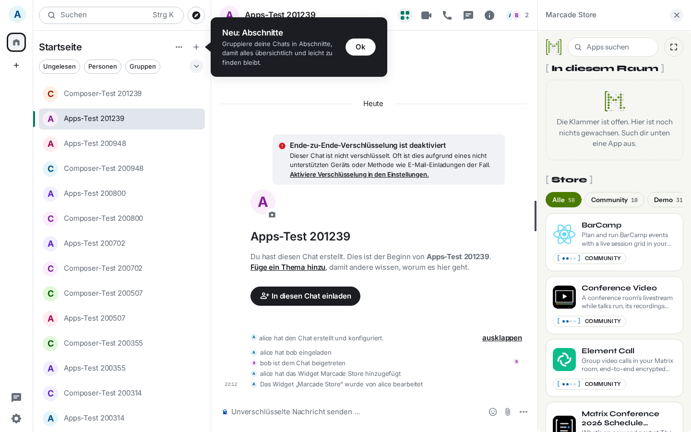
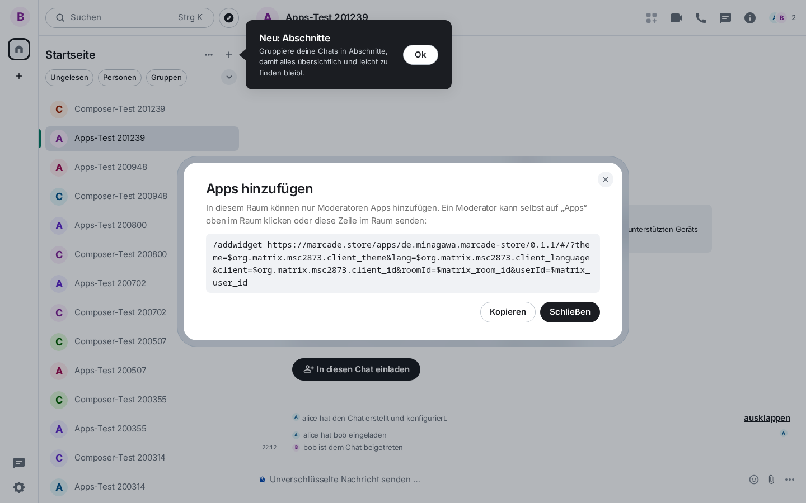
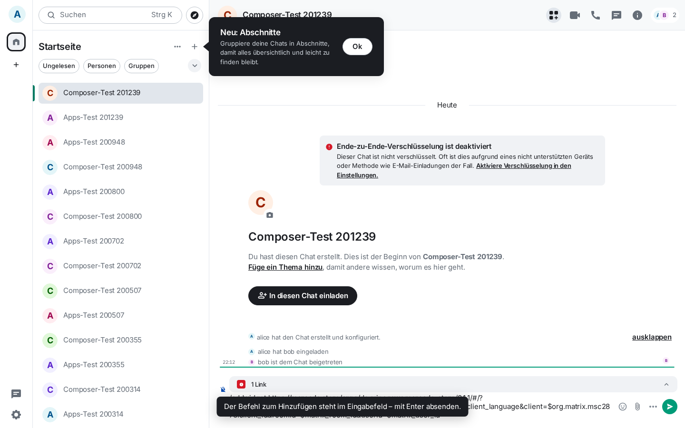

# marcade-element-module

An [Element Web module](https://github.com/element-hq/element-web/tree/develop/packages/module-api) that puts a
Marcade **Apps** button into every room header. One click shows the
[Marcade Store](https://marcade.store) widget for that room:

| Situation | What the click does |
|---|---|
| (a) the store is already in the room | opens it in the right panel (second click closes it); if it is pinned above the timeline or maximised it is already on screen and nothing moves |
| (b) not in the room, you may add widgets | adds it exactly like `/addwidget` would, waits until Element has it, opens it in the right panel |
| (c) not in the room, you may not add widgets | the button looks disabled (still focusable); the click opens a dialog: only moderators can add apps, with the `/addwidget …` line to hand to one |
| (d) this Element exposes no client (future versions) | puts `/addwidget …` into the composer, you press Enter |

The store's own capability requests are approved automatically (no consent dialog), and so is loading it
("Continue"), but only for widgets whose URL lies under the configured prefixes.



| moderator dialog (c) | composer fallback (d) |
|---|---|
|  |  |

Texts follow Element's language (German and English included). The button is a real `<button>`: Tab-reachable,
Enter/Space activate it, accessible name "Apps", tooltip (`title` / `aria-description`) "Marcade Store öffnen" /
"Open Marcade Store", `aria-pressed` while the store is open in the right panel.

## Requirements

Element Web with module API ≥ 1.14 (declared `^1.14.0 || ^2.0.0`): checked against Element Web 1.12.30 (module
API 2.2.0) in the e2e below; element.datanauten.de (fork of 1.12.27) and openDesk's Element 1.12.29 ship
`addRoomHeaderButtonCallback`, `getWidgetsInRoom`, `moveAppToContainer`, `insertPlaintextIntoComposer` and
`registerShouldShowComponent`. Every API call is feature-checked and wrapped: if something is missing the button
is simply not shown (or falls back as above), Element itself never breaks.

## Install

Build once (or take `dist/index.js` from a release):

```sh
npm ci && npm run build        # → dist/index.js, one ES module, React comes from Element (window.React)
```

**Official Element image** (`vectorim/element-web`): mount the build at `/modules/marcade`. The image's entrypoint
(`/docker-entrypoint.d/18-load-element-modules.sh`) adds every `/modules/<name>/index.js` — or the `main` of a
`/modules/<name>/package.json` — to `config.json`'s `modules`, so no config change is needed:

```sh
podman run -v ./dist:/modules/marcade:ro -v ./config.json:/app/config.json:ro … docker.io/vectorim/element-web:v1.12.30
```

Mounting the whole repo checkout at `/modules/marcade` works too (`package.json` `"main": "dist/index.js"`).

**Any other Element hosting**: serve `index.js` somewhere on the Element origin and list it yourself:

```json
{ "modules": ["/modules/marcade/index.js"] }
```

Listed twice (both ways at once) it loads only once.

## Configuration

Optional block in Element's `config.json`; without it the module works with the defaults shown:

```json
"de.minagawa.marcade_element_module": {
  "store_url": "https://marcade.store/apps/de.minagawa.marcade-store/0.1.1/",
  "store_prefix": "https://marcade.store/apps/de.minagawa.marcade-store/",
  "approve_prefixes": ["https://marcade.store/apps/de.minagawa.marcade-store/"],
  "approve_identity": false,
  "hide_integrations": false,
  "show_in_dms": true,
  "open_in": "right"
}
```

| key | meaning |
|---|---|
| `store_url` | the store build that gets added. The module appends the store's template fragment (`#/?theme=$org.matrix.msc2873.client_theme&lang=…&roomId=$matrix_room_id&userId=$matrix_user_id`, the same line the store's own `/addwidget` uses) unless the URL already has a `#…` fragment. http(s) only. |
| `store_prefix` | a room widget whose URL starts with this counts as "the store", whatever version. Default: `store_url` without its version folder. Ignored if it would not match `store_url` (otherwise every click would add another store). |
| `approve_prefixes` | widgets whose URL starts with one of these are preloaded without "Continue" and get the store's capabilities approved. Default: `[store_prefix]`. `[]` switches all approvals off. Prefixes are compared on the parsed origin + path and always end in `/`, so `…/marcade-store/` never matches `…/marcade-store-evil/`, another host, `user@host` tricks or `..` paths. |
| `approve_identity` | also approve OpenID (identity) requests for those widgets. The store makes no network requests and needs none, so off. |
| `hide_integrations` | hide `UIComponent.AddIntegrations` ("Add extensions" in the Extensions card; the path that ends in "Integrations not allowed" when no integration manager is configured). Note: Element also disables its `/addwidget` command with it, so in that case (d) shows the line in a dialog instead of the composer. |
| `show_in_dms` | `false` hides the button in DMs (rooms in your `m.direct`). |
| `open_in` | `"right"` (right panel) or `"top"` (pinned above the timeline, module API only, no internals). |

Capabilities approved, and only these (from the store's `catalog-entry/de.minagawa.marcade-store/metadata.yml`):

```
org.matrix.msc2762.receive.state_event:im.vector.modular.widgets
org.matrix.msc2762.receive.state_event:m.widget
org.matrix.msc2762.receive.state_event:io.element.widgets.layout
org.matrix.msc2762.send.state_event:im.vector.modular.widgets
org.matrix.msc2762.send.state_event:io.element.widgets.layout
org.matrix.msc4039.upload_file
```

Anything else a widget asks for still goes through Element's normal consent dialog. Element allows one approver of
each kind per app: if another module (e.g. opendesk-element-module) registered one first, this module logs a warning
and that kind keeps Element's normal consent.

## How it works, and the module API gaps

| step | API used |
|---|---|
| header button | `api.extras.addRoomHeaderButtonCallback` (alpha) |
| find the store | `api.widget.getWidgetsInRoom` |
| open | `api.widget.moveAppToContainer(w, "right")` + **`window.mxSdkContext.rightPanelStore.setCard({phase: "Widget", state: {widgetId}})`**; fallback `moveAppToContainer(w, "top")` |
| permission check | **`window.mxMatrixClientPeg.get().getRoom(id).currentState.maySendStateEvent("im.vector.modular.widgets", me)`** (+ joined), the rule of Element's `WidgetUtils.canUserModifyWidgets` |
| add | **`window.mxMatrixClientPeg.get().sendStateEvent(roomId, "im.vector.modular.widgets", content, id)`** |
| moderator dialog | `api.openDialog` |
| composer fallback | `api.composer.insertPlaintextIntoComposer` |
| approvals | `api.widgetLifecycle.register{Preload,Capabilities,Identity}Approver` |
| hide integrations | `api.customisations.registerShouldShowComponent` |
| DM check | `m.direct` via the client, else `api.client.accountData` |

The event content mirrors Element's `/addwidget` (`SlashCommands.tsx` → `WidgetUtils.setRoomWidget`):
`{type: "m.custom", url, name, data: {}}`, plus `id` and `creatorUserId` as in the widget event spec; state key
`marcade_store_<timestamp>`. `name` is "Marcade Store" (the store then brands its own event with name and icon).
Element appends nothing to the URL; the `$matrix_*` template is part of `store_url`'s fragment. Like `/addwidget`,
no `io.element.widgets.layout` is written, so nobody's layout is overridden.

Gaps (each could become a small module API addition):

1. **Opening a widget in the right panel.** `moveAppToContainer(w, "right")` only "unpins": in `WidgetLayoutStore`
   "right" is the default, not-shown container, and the right panel's `WidgetCard` is opened by
   `RightPanelStore.setCard/pushCard` (what Element's Extensions list does), which the module API does not expose.
   Decision: use the debugging global `window.mxSdkContext` (set unconditionally in `MatrixChat.tsx`, same kind of
   stopgap as `mxMatrixClientPeg`), not the dispatcher (`mxDispatcher` has no right-panel action for widgets anyway).
   Feature-checked; without it the store is pinned to the top instead (`open_in: "top"` does that on purpose).
2. **Sending state / reading power levels.** No module API for either; `window.mxMatrixClientPeg` is the stopgap.
   Without it: (d), composer fallback.
3. **No toast API**: status lines are a small `role="status"` element of the module's own.
4. **No Compound components** (IconButton, Tooltip) in the module API: the button copies the 32 px icon button with
   Compound CSS variables and uses a native `title` tooltip.

## Development

```sh
npm run check     # tsc
npm test          # vitest: config, URL matching, state event content, click logic with fake Element
npm run build     # dist/index.js
npm run e2e:stack # throwaway Synapse (127.0.0.1:18448) + Element 1.12.30 with dist/ at /modules/marcade (5791)
                  # + a second Element with hide_integrations (5792); state in e2e/.run, podman
npm run e2e       # Playwright against that stack; screenshots in e2e/out/
npm run e2e:down
```

The e2e loads the real store from marcade.store into the widget iframe (read-only; nothing is published).

## Licence

Apache-2.0, see [LICENSE](LICENSE).
