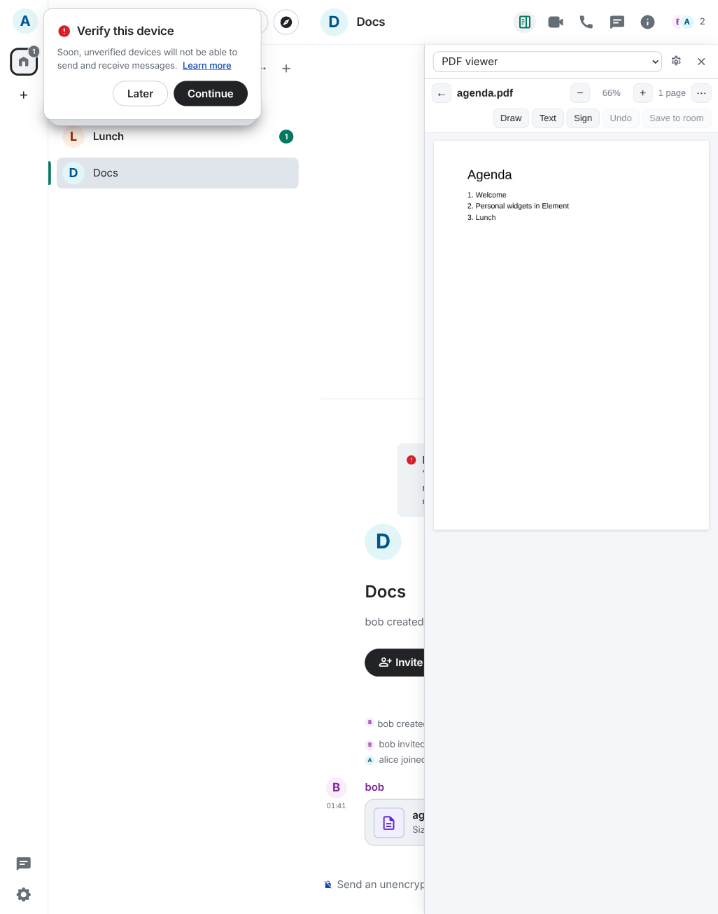
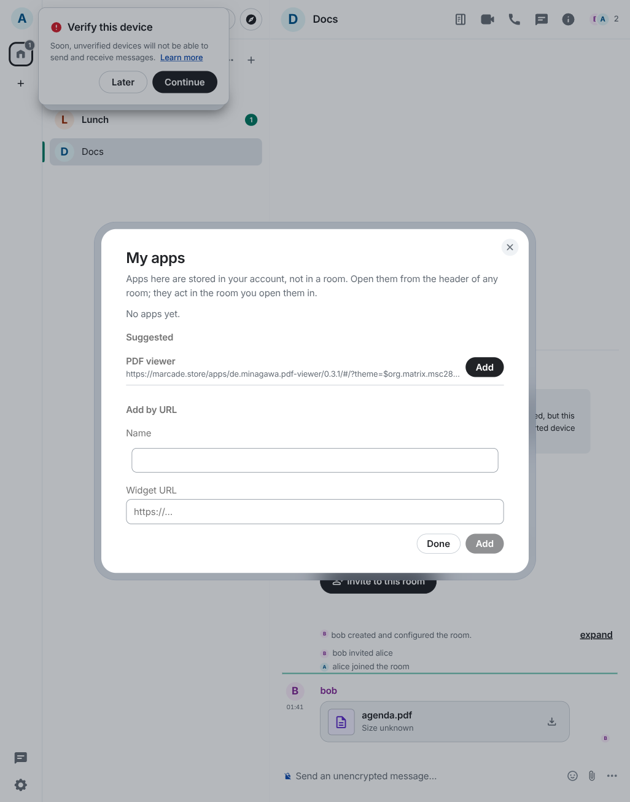
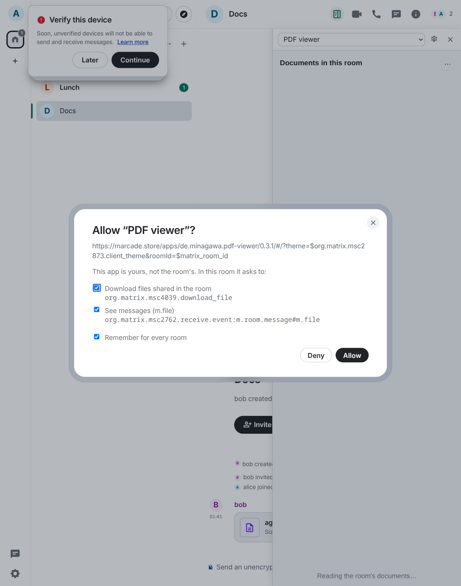
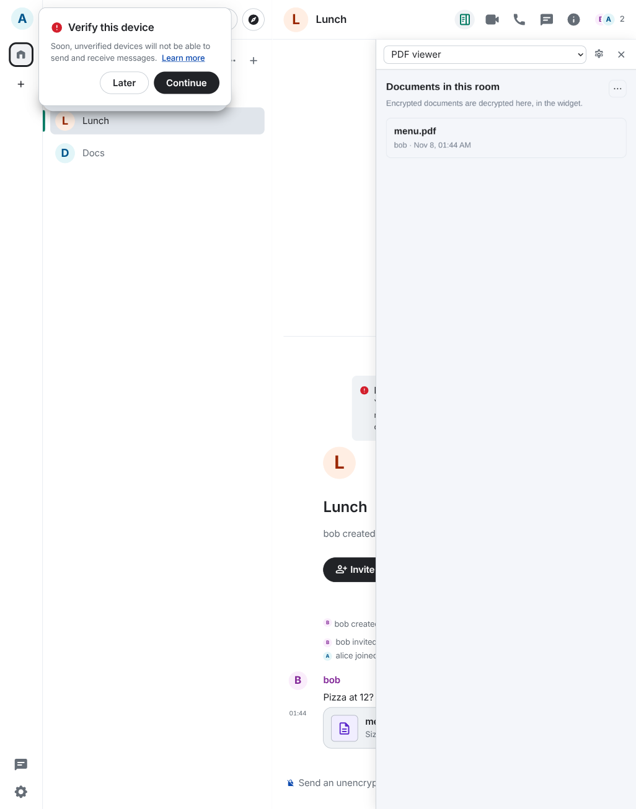

# My apps: personal widgets for Element Web

Use widgets without adding them to a room. A PDF viewer, a participant panel or any other [Matrix widget](https://marcade.store) is stored in your account and opens in every room from a **My apps** button in the room header. The room never gets a widget event, so nobody else sees it, and you need no permission to add widgets.

Click **My apps** in a room's header. The first time, you pick an app from the suggestions or paste a widget URL. After that, the button opens your last app in a panel on the right. It acts in the room you are looking at, and when you switch rooms it starts again in the new one.



| | |
| --- | --- |
| Where apps are stored | Account data `m.widgets`, the same "user widgets" event Element uses for the sticker picker (which is left alone and not listed). Your apps follow you to every device. |
| What a widget sees | Only the room it is opened in. Each room switch restarts it, so its URL (`$matrix_room_id`) and everything it reads belong to one room. |
| Consent | On first use the widget's requested capabilities are listed with a checkbox each. The answer is remembered for every room and device in account data `de.datanauten.user_account_widgets`, tied to the widget's URL: change the URL and it asks again. |
| Never granted | Room widget state (`im.vector.modular.widgets`, `m.widget`, `io.element.widgets.layout`), because writing it would put the widget into the room. Also OpenID, stickers, always-on-screen, delayed and sticky events and calls. Requests for them are dropped without a prompt. |
| Refused outright | Widgets served from Element's own origin, because they could read Element's storage. |
| Panel | Docked right, below the room header. Its width can be dragged and is remembered. Element's dialogs and menus stay on top of it. |

| first use | consent | the same app in another room |
| --- | --- | --- |
|  |  |  |

## Configuration

Optional, in Element's `config.json`:

```json
"de.datanauten.user_account_widgets": {
    "suggested": [
        { "name": "PDF viewer", "url": "https://marcade.store/apps/de.minagawa.pdf-viewer/0.3.1/#/?theme=$org.matrix.msc2873.client_theme&roomId=$matrix_room_id" }
    ],
    "approve_prefixes": ["https://marcade.store/apps/de.minagawa.pdf-viewer/"]
}
```

| key | meaning |
| --- | --- |
| `suggested` | Apps offered in the dialog with one click. Only http(s) URLs are used. |
| `approve_prefixes` | Widgets whose URL starts with one of these get every capability they ask for (except those never granted, above) without a prompt. The same idea as Element's `widget-lifecycle` module, for personal widgets. |

## How it works

Element only renders `m.widgets` entries of type `m.stickerpicker`, and the module API has no way to host a widget. So the module hosts widgets itself:

- **Button:** `extras.addRoomHeaderButtonCallback`, styled like Compound's header icon buttons.
- **Widget API:** the same `ClientWidgetApi` from `matrix-widget-api` that Element uses, with a driver modelled on Element's `ElementWidgetDriver`, bundled into the module. It implements sending and reading room and state events, to-device messages (encrypted too), relations, user directory search, media upload and download (authenticated media, with your access token), and remembers or asks for consent.
- **Live events:** fed from Element's own Matrix client (`window.mxMatrixClientPeg`). Only live timeline events of the open room are fed, after decryption, plus its state changes and to-device messages. Backfill and history are not fed.
- **Current room:** from `window.mxSdkContext.roomViewStore`, with the URL hash as a fallback.
- **Theme:** from Compound's class on `<html>`. Widgets get `theme_change` when it changes.
- **Panel layer:** Element puts each overlay layer (persisted widgets, dialogs, menus) in its own `isolation: isolate` container after `#matrixchat`. The panel gets one of its own just before them, so it covers the room but every dialog covers it.

## Limitations

- **One room at a time.** A widget that wants to follow several rooms at once (`org.matrix.msc2762.timeline:*`) gets the capability if you allow it, but its iframe still restarts on every room switch.
- **Restart on room switch.** A widget loses unsaved input when you change rooms. That's the price of never letting it see the wrong room.
- **Not on other clients.** Element X, the Marcade Player and other clients don't show these widgets. The `m.widgets` entries are standard, so a client could.
- **Relies on Element internals:** `mxMatrixClientPeg`, `mxSdkContext.roomViewStore`, `.mx_RoomHeader` and the overlay containers. Checked against Element Web v1.12.32 and develop (November 2026). Without the client the button is not shown. Without the room store the URL hash is used. Without the header element the panel starts at the top of the window.
- **Widgets that only read once.** The PDF viewer lists a room's documents when it starts and ignores live events (`send_event`), so a PDF posted while it is open shows up after the next room switch. A room-pinned PDF viewer behaves the same way.

## Requirements

Element Web with module API 2.x (`openDialog`, `client.accountData`, `extras.addRoomHeaderButtonCallback`).

## Development

```sh
pnpm install
pnpm test          # vitest (jsdom): m.widgets, capabilities and consent, driver, event feed, panel, module
pnpm lint:types
pnpm build         # → lib/index.js, one ES module (matrix-widget-api bundled; React from Element)
e2e/stack.sh up    # Synapse :18478 + Element Web v1.12.32 :5808 with lib/ mounted, rooms "Docs" (a PDF from bob) and "Lunch"
e2e/stack.sh down
```

## License

AGPL-3.0-only, see [LICENSE](LICENSE).
